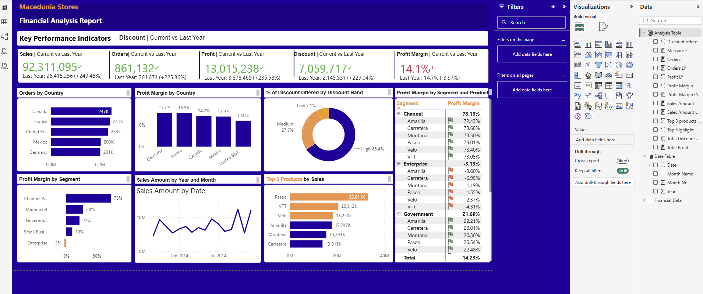

# Macedonia Stores | Financial Analysis Dashboard

## Project Overview
An interactive financial analysis dashboard developed using Microsoft Power BI to explore sales performance, profitability, discount distribution, product performance, and business segments.

## Business Objectives
- Monitor key financial performance indicators.
- Compare current-year performance with the previous year.
- Analyse order distribution and profit margins across countries.
- Evaluate discount bands and their contribution to total discounts.
- Identify top-performing products by sales.
- Compare profitability across business segments and products.

## Tools & Technologies
- **Power BI Desktop** — dashboard development and visualisation
- **DAX** — measures and financial calculations
- **Power Query** — data preparation and transformation
- **Data Modelling** — relationships and date analysis

## Dashboard Features
- Sales, orders, profit, discount and profit margin KPIs
- Country-level order and profitability analysis
- Discount-band distribution
- Segment and product profitability comparison
- Monthly sales trend analysis
- Top products by sales

## Data Source
This project uses sample financial data for educational and portfolio purposes.

**Dataset source:** [Insert the original dataset source link here.]

The dataset should not be interpreted as actual financial results for a real company unless independently verified.

## Key Findings
Add three to five findings based on the results shown in your dashboard. Include the relevant figures and explain what they mean for business performance.

## Project Files
- `Macedonia_Stores_Financial_Analysis.pbix` — Power BI report file
- `dashboard-preview.png` — dashboard screenshot

## How to Explore
1. Download the `.pbix` file from this repository.
2. Open it in Power BI Desktop.
3. Explore the report visuals, filters, measures and financial comparisons.

## Disclaimer
This is an educational portfolio project using sample data. The analysis demonstrates business intelligence and financial reporting techniques and is not financial advice.
